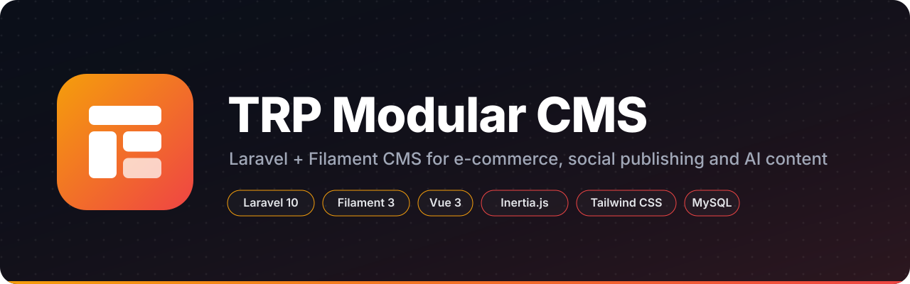
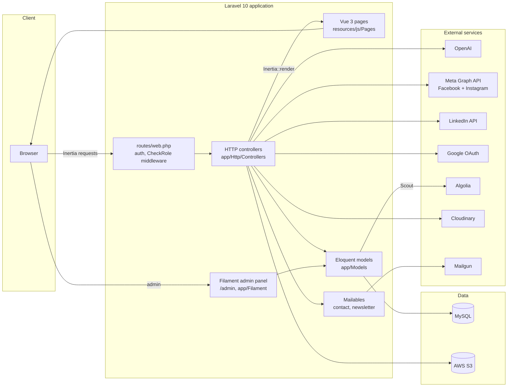

<div align="center">
  
  <p><b>A modular Laravel + Filament CMS that runs a product catalogue, online orders, social publishing and AI-assisted content from one admin panel.</b></p>
  <p>
    
    
    
    
    
    
    <br />
    <a href="LICENSE"></a>
    
    
    <a href="CONTRIBUTING.md"></a>
  </p>
  <p><a href="#-quick-start">Quick start</a> · <a href="#-features">Features</a> · <a href="#-architecture">Architecture</a> · <a href="#-contributing">Contributing</a></p>
</div>

## Overview

TRP Modular CMS is a full-stack content and commerce platform built with **Laravel 10** and **Filament 3** on the back end and **Vue 3 + Inertia.js + Tailwind CSS** on the front end. It was originally built to power [trp-france.fr](https://trp-france.fr), a French professional radio-communication business, and is published here as a production-grade case study.

Editors manage the whole site from a Filament admin panel: catalogue, orders, landing-page content, blog, newsletter, support tickets and roles. Customers browse a filterable catalogue, build a cart, place standard or special orders and open support tickets. Staff can publish to Facebook, Instagram and LinkedIn and draft marketing copy with OpenAI without leaving the application.

## ✨ Features

**Administration**
- **Filament 3 admin panel** at `/admin` with 40+ resources, an orders chart widget, route statistics, and page settings for logo, favicon and landing video.
- **Media library and page builder** through Filament Curator and Filament Fabricator (default and blog layouts).
- **Role-based access** with Spatie Permission. Seeded roles: Super Admin, Admin, Editor, User and Customer.
- **Navigation management**: menus and menu items (tree editor), header, carousel and sliders.

**Catalogue and commerce**
- **Rich product catalogue**: products, accessories, brands, categories, series, models, types, antenna types, batteries, chargers and frequency bands.
- **Multi-criteria filtering** of products and accessories, featured products and "customers also bought" suggestions.
- **Cart and checkout** with quantity updates, order history, order editing and item removal.
- **Special orders** for accessories and offers, with their own checkout and order list.
- **Product reviews** and customer feedback.
- **Instant search** with Laravel Scout, Algolia and Vue InstantSearch.

**Content and engagement**
- **Offers, services, applications and activity sectors**, each with detail pages, appointment booking (reservations) and dedicated contact forms.
- **Service warranties and quick reference guides** managed from the admin panel.
- **Blog** with categories, authors and post likes.
- **Newsletter** subscribers and newsletter mailing, plus a contact form delivered by mail.
- **Support ticketing**: customers open tickets and exchange messages; staff assign, close, reopen and track them.

**Integrations**
- **Social publishing** through the Meta Graph API: Facebook page posts with images or video, and Instagram single images, carousels, reels and stories. Media is staged on Cloudinary.
- **LinkedIn** sign-in and post sharing.
- **AI content generator** (OpenAI) with templates for social posts, marketing plans, blog posts, email campaigns, market research and more, restricted to staff roles.
- **Authentication** with Laravel Breeze, Sanctum and Google sign-in through Socialite; user profiles with avatar and cover uploads.
- **Localisation** in French (default) and English.

## 🧱 Tech stack

| Layer | Technology |
| --- | --- |
| Language | PHP 8.1+ (Sail image uses 8.2), JavaScript (ES modules) |
| Back end | Laravel 10, Laravel Sanctum, Laravel Socialite, Laravel Scout |
| Admin panel | Filament 3, Filament Curator, Filament Fabricator, Filament Blog, Filament Apex Charts, Filament Tree |
| Front end | Vue 3, Inertia.js, Pinia, Tailwind CSS 3, Headless UI, Flowbite, Vite 4 |
| Data | MySQL 8 (via Sail), Eloquent, Spatie Permission, Laravel Ticket, Lara Reserve |
| Search | Algolia (Scout driver) with Vue InstantSearch |
| Media | AWS S3, Cloudinary, FilePond uploads, FFmpeg (Laravel FFmpeg) |
| Integrations | OpenAI PHP client, Meta Graph API, LinkedIn API, Google OAuth, Mailgun |
| Tooling | Laravel Sail, Laravel Telescope, Laravel Pint, PHPUnit, ESLint, Prettier |
| Deployment | Docker (Sail), Dev Container, AWS Elastic Beanstalk (`.ebextensions`, `.platform`) |

## 🏗 Architecture



**Request flow.** Public and customer pages are served by controllers in `app/Http/Controllers`, which return Inertia responses rendered by Vue single-file components in `resources/js/Pages`. Staff-only routes (AI generator, ticket administration) sit behind the `CheckRole` middleware. The Filament panel at `/admin` discovers its resources, pages and widgets from `app/Filament`.

```
app/
├── Filament/
│   ├── Fabricator/Layouts/   # Page-builder layouts (default, blog)
│   ├── Pages/                # Dashboard, logo, favicon, landing video
│   ├── Resources/            # 40+ admin resources (products, orders, tickets, ...)
│   └── Widgets/              # Orders chart
├── Http/
│   ├── Controllers/          # Storefront, cart, orders, social, AI, tickets
│   └── Middleware/           # CheckRole and Inertia middleware
├── Mail/                     # Contact and newsletter mailables
├── Models/                   # Eloquent models
└── Providers/                # Filament panel, Socialite and Telescope providers
resources/js/
├── Components/               # Shared Vue components
├── Layouts/                  # Page layouts
├── Pages/                    # Inertia pages
└── stores/                   # Pinia stores
```

## 🚀 Quick start

### Prerequisites

- [Docker Desktop](https://www.docker.com/get-started) (WSL2 backend on Windows)
- [Git](https://git-scm.com/)
- PHP 8.1+ and [Composer](https://getcomposer.org/download/) on the host, **or** use the one-off Docker command shown below

### 1. Clone and configure

```bash
git clone https://github.com/ismailbentabett/trp-project.git
cd trp-project
cp .env.example .env
```

Fill in `.env` using the [Configuration](#%EF%B8%8F-configuration) table. For a local Sail setup, at minimum set `APP_URL`, the `DB_*` values and the driver values.

### 2. Install PHP dependencies

With PHP and Composer installed locally:

```bash
composer install
```

Or without a local PHP installation:

```bash
docker run --rm -u "$(id -u):$(id -g)" -v "$(pwd):/var/www/html" -w /var/www/html \
  laravelsail/php82-composer:latest composer install --ignore-platform-reqs
```

### 3. Start the containers

```bash
./vendor/bin/sail up -d
```

This starts the app (PHP 8.2, built from `docker/8.2`), MySQL 8 and phpMyAdmin as defined in `docker-compose.yml`. You may want a shell alias: `alias sail='./vendor/bin/sail'`.

### 4. Prepare the application

```bash
sail artisan key:generate
sail artisan migrate --seed   # seeds roles, demo users, menus, categories, brands and ticket metadata
sail artisan storage:link
```

The seeders create one demo user per role. See `database/seeders/DatabaseSeeder.php` for the accounts and change them before any shared deployment.

### 5. Build the front end

```bash
sail npm install
sail npm run dev      # Vite dev server with hot reload
# or
sail npm run build    # production assets
```

### 6. Open the app

| Service | URL |
| --- | --- |
| Storefront | http://localhost:8000 |
| Admin panel | http://localhost:8000/admin |
| Vite dev server | http://localhost:5173 |
| phpMyAdmin | http://localhost:8081 |
| Telescope (local) | http://localhost:8000/telescope |

Stop everything with `sail down`.

### Useful commands

| Task | Command |
| --- | --- |
| Run tests | `sail artisan test` |
| Format PHP | `sail pint` |
| Lint JS / Vue | `npm run lint` |
| Format front end | `npm run format` |
| Re-index search | `sail artisan scout:import "App\Models\Product"` |

### Deployment

The repository ships configuration for **AWS Elastic Beanstalk** (PHP platform on Amazon Linux):

- `.ebextensions/01-deploy.config` sets the document root to `/public`, installs Composer dependencies and runs migrations on the leader instance.
- `.platform/hooks/prebuild` installs the PHP zip extension and Node.js 18.
- `.platform/hooks/postdeploy` caches config and routes, makes `storage/` and `bootstrap/cache/` writable and links storage.
- `.platform/nginx` and `.platform/files` hold the Nginx, PHP and Supervisor overrides.

A **Dev Container** definition (`.devcontainer/devcontainer.json`) reuses the Sail `docker-compose.yml` for VS Code and GitHub Codespaces.

## ⚙️ Configuration

All configuration is read from `.env`. The template `.env.example` lists every key with an empty value. Suggested local values are shown for a Sail setup.

| Variable(s) | Purpose | Local example |
| --- | --- | --- |
| `APP_NAME`, `APP_ENV`, `APP_KEY`, `APP_DEBUG`, `APP_URL` | Core application settings (`APP_KEY` is set by `key:generate`) | `trp`, `local`, generated, `true`, `http://localhost:8000` |
| `VITE_APP_NAME`, `VITE_APP_URL` | Values exposed to the Vue front end | `trp`, `http://localhost:8000` |
| `DB_CONNECTION`, `DB_HOST`, `DB_PORT`, `DB_DATABASE`, `DB_USERNAME`, `DB_PASSWORD` | Database connection (also used by the MySQL container) | `mysql`, `mysql`, `3306`, `trp`, `sail`, `password` |
| `CACHE_DRIVER`, `SESSION_DRIVER`, `SESSION_LIFETIME`, `QUEUE_CONNECTION`, `BROADCAST_DRIVER` | Runtime drivers | `file`, `file`, `120`, `sync`, `log` |
| `FILESYSTEM_DISK`, `FILAMENT_FILESYSTEM_DISK`, `FILEPOND_TEMP_DISK` | Storage disks for uploads and admin media | `public`, `public`, `public` |
| `AWS_*` | S3 bucket for file storage (when `FILESYSTEM_DISK=s3`) | |
| `MAIL_*`, `MAILGUN_*` | Outgoing mail for the contact form and newsletter | |
| `REDIS_*`, `MEMCACHED_HOST` | Optional cache backends | |
| `PUSHER_*`, `VITE_PUSHER_*` | Optional real-time broadcasting | |
| `SCOUT_DRIVER`, `SCOUT_QUEUE`, `ALGOLIA_APP_ID`, `ALGOLIA_SECRET` | Server-side search indexing | `algolia`, `true` |
| `VITE_ALGOLIA_APP_ID`, `VITE_ALGOLIA_SEARCH_KEY` | Front-end instant search. **Bundled into public JS: use a search-only key** | |
| `OPENAI_API_KEY`, `OPENAI_ORGANIZATION` | AI content generator | |
| `FACEBOOK_APP_ID`, `FACEBOOK_APP_SECRET`, `FACEBOOK_REDIRECT_URI` | Facebook page and Instagram publishing | `http://localhost:8000/auth/facebook/callback` |
| `LINKEDIN_CLIENT_ID`, `LINKEDIN_CLIENT_SECRET`, `LINKEDIN_REDIRECT_URI` | LinkedIn sign-in and sharing | `http://localhost:8000/linkedin/callback` |
| `SOCIAL_AUTH_GOOGLE_KEY`, `SOCIAL_AUTH_GOOGLE_SECRET`, `SOCIAL_AUTH_GOOGLE_REDIRECT_URI` | Google sign-in | `http://localhost:8000/auth/google/callback` |
| `CLOUDINARY_*` | Media staging for social posts | |
| `FFMPEG_BINARIES`, `FFPROBE_BINARIES` | FFmpeg paths for video processing | `/usr/bin/ffmpeg`, `/usr/bin/ffprobe` |
| `TELESCOPE_ENABLED` | Toggle Laravel Telescope | `true` locally, `false` in production |
| `APP_PORT`, `VITE_PORT`, `FORWARD_DB_PORT` | Optional Sail port overrides | |

Integrations are optional for local development: features that depend on a missing key (social publishing, AI, search) will fail only when used.

## 📁 Project structure

```
.
├── app/                  # Laravel application code (Filament, controllers, models, mail)
├── bootstrap/            # Framework bootstrap
├── config/               # Laravel and package configuration
├── database/             # Migrations, factories and seeders
├── docker/               # Sail Dockerfiles (PHP 8.0 to 8.3) and DB init scripts
├── lang/                 # French and English translations
├── public/               # Web root and compiled assets
├── resources/
│   ├── css/              # Tailwind entry points
│   ├── js/               # Vue 3 + Inertia front end
│   └── views/            # Blade root template and mail views
├── routes/               # web, api, auth, channels and console routes
├── tests/                # PHPUnit feature and unit tests
├── .devcontainer/        # VS Code Dev Container
├── .ebextensions/        # AWS Elastic Beanstalk options and commands
├── .platform/            # Elastic Beanstalk hooks, Nginx and PHP overrides
└── docker-compose.yml    # Sail services: app, MySQL, phpMyAdmin
```

## 🗺 Roadmap

- [ ] Continuous integration running Pint, ESLint and PHPUnit on every pull request
- [ ] Broader feature test coverage for cart, orders, special orders and tickets
- [ ] Move the AI generator to the OpenAI Chat Completions API and current models
- [ ] Make the Facebook page and Instagram account fully configurable from the admin panel
- [ ] Enable TLS certificate verification on all outbound HTTP clients
- [ ] Upgrade to Laravel 11 and the latest Filament 3 release
- [ ] Production Docker image as an alternative to Elastic Beanstalk

## 🤝 Contributing

Contributions are welcome. Read [CONTRIBUTING.md](CONTRIBUTING.md) for the development workflow and coding standards, and follow the [Code of Conduct](CODE_OF_CONDUCT.md).

## 🔒 Security

Please report vulnerabilities privately as described in [SECURITY.md](SECURITY.md). Do not open public issues for security problems.

## 📄 License

Released under the [MIT License](LICENSE).

---

<div align="center">
  <p>Built by <b>Ismail Bentabett</b> · <a href="https://github.com/ismailbentabett">GitHub</a> · <a href="https://ismailbentabett.com">ismailbentabett.com</a></p>
  <p>⭐ Star this repo if you find it useful</p>
</div>
